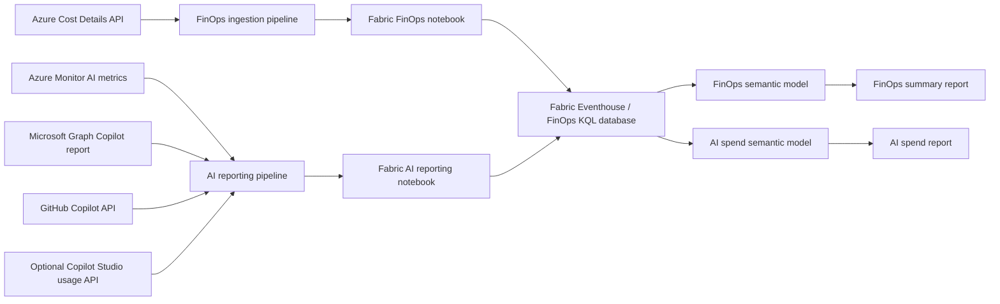

# Fabric FinOps toolkit

This folder is a standalone, Fabric-native implementation of the FinOps toolkit architecture. It replaces the original Azure Data Factory and Azure Data Explorer deployment with Microsoft Fabric items:

- Fabric Data Factory pipelines for orchestration.
- Fabric notebooks for authenticated extraction and normalization.
- A Fabric Eventhouse and KQL database for cost, usage, and operational data.
- DirectQuery Power BI semantic models.
- FinOps summary and AI spend Power BI reports.

The source systems are necessarily external. Azure Cost Management, Azure Monitor, Microsoft Graph, GitHub, and optional Copilot Studio endpoints remain the systems of record, but the data platform and reporting implementation run in Fabric.

## Installation quickstart

### 1. Open PowerShell

Use PowerShell 7.2 or later:

```powershell
Set-Location C:\FinOpsOnFabric\fabric-finops-toolkit
```

Confirm the PowerShell version:

```powershell
$PSVersionTable.PSVersion
```

### 2. Sign in to Azure and Fabric

Use either Azure PowerShell:

```powershell
Install-Module Az.Accounts -Scope CurrentUser
Connect-AzAccount
```

Or Azure CLI:

```powershell
az login
az account set --subscription "<subscription-id>"
```

The deployment script requests a token for `https://api.fabric.microsoft.com` from the active account.

### 3. Create the configuration

Copy the example:

```powershell
Copy-Item .\config.example.json .\config.json
```

Edit `config.json` and replace the sample capacity and subscription IDs:

```json
{
  "workspace": {
    "displayName": "FinOps on Fabric",
    "capacityId": "<fabric-capacity-guid>"
  },
  "eventhouse": {
    "displayName": "FinOpsEventhouse",
    "databaseName": "FinOps",
    "cachePeriod": "P30D",
    "storagePeriod": "P3650D"
  },
  "costManagement": {
    "scopes": [
      "/subscriptions/<subscription-guid>"
    ],
    "lookbackDays": 45
  },
  "ai": {
    "microsoftGraphEndpoint": "",
    "githubOrganizations": [],
    "githubTokenSecretName": "",
    "copilotStudioUsageEndpoint": "",
    "copilotStudioTokenSecretName": "",
    "lookbackDays": 45
  },
  "keyVaultUri": ""
}
```

The capacity ID must be the GUID of a Fabric-enabled capacity, not its display name. Leave optional AI provider settings empty for the first deployment if those permissions and secrets aren't ready.

### 4. Validate the package

```powershell
pwsh .\tests\validate.ps1
```

Expected result:

```text
Validated JSON, required artifacts, Eventhouse objects, and deployment tokens.
```

### 5. Deploy to Fabric

Create the workspace and all Fabric items without starting ingestion:

```powershell
pwsh .\deploy.ps1
```

The command is idempotent by item display name. Running it again updates the existing item definitions.

The deployment creates:

- A Fabric workspace assigned to the configured capacity.
- An Eventhouse and `FinOps` KQL database.
- FinOps and AI ingestion notebooks.
- FinOps and AI reporting pipelines.
- FinOps and AI semantic models.
- FinOps summary and AI spend reports.

Created item IDs are written to `deployment-output.json`.

### 6. Configure the Fabric notebook environment

In the Fabric portal:

1. Open the deployed workspace.
2. Create or open a Fabric Environment.
3. Add these PyPI libraries:

   ```text
   azure-kusto-data
   azure-kusto-ingest
   ```

4. Publish the environment.
5. Attach it to:
   - **FinOps Ingestion**
   - **AI Reporting Ingestion**

### 7. Grant runtime permissions

Grant the identity that runs the notebooks and pipelines:

- `Cost Management Reader` on every configured cost scope.
- `Reader` and `Monitoring Reader` on subscriptions containing Microsoft Foundry or Azure OpenAI resources.
- Access to the deployed Fabric workspace and KQL database.
- Microsoft Graph reporting access when Microsoft 365 Copilot collection is enabled.
- `Key Vault Secrets User` on only the required secrets when optional provider tokens are used.

Never store provider secrets directly in `config.json`.

### 8. Run the first ingestion

Run the pipelines from the Fabric portal in this order:

1. **FinOps Ingestion**
2. **AI Reporting**

After libraries and permissions are ready, you can also start both pipelines from the deployment command:

```powershell
pwsh .\deploy.ps1 -RunPipelines
```

### 9. Verify the installation

Open the Eventhouse and run:

```kusto
IngestionRuns
| order by StartedAt desc
```

Check loaded cost records:

```kusto
Costs()
| summarize Records=count(), LatestCharge=max(ChargePeriodStart)
```

Check AI usage and attributed spend:

```kusto
AISpend()
| summarize
    EffectiveCost=sum(EffectiveCost),
    Tokens=sum(TotalTokens),
    Requests=sum(Requests)
    by Provider, Product, Currency
```

Then open:

- **FinOps Summary Report**
- **AI Spend Report**

The semantic models use DirectQuery against the Eventhouse.

### 10. Schedule daily ingestion

Create schedules in the Fabric portal:

1. Schedule **FinOps Ingestion** once per day.
2. Schedule **AI Reporting** after FinOps ingestion normally completes.
3. Monitor failures and row-count changes in `IngestionRuns`.

## Installation troubleshooting

### Capacity assignment fails

Confirm that:

- `workspace.capacityId` contains the capacity GUID.
- The capacity supports Microsoft Fabric workloads.
- Your account can create workspaces and assign them to that capacity.

### Cost ingestion returns 401 or 403

Grant `Cost Management Reader` on every configured scope. For billing-account or billing-profile scopes, make sure the permission is granted at that billing scope rather than only at subscription level.

### AI metrics are empty

Confirm that:

- Relevant resources are Azure OpenAI or Microsoft Foundry resources.
- The notebook identity has `Reader` and `Monitoring Reader`.
- Azure Monitor exposes token, request, or transaction metrics for the resource type and region.
- The selected lookback period contains activity.

### A notebook can't import an Azure Kusto package

Add `azure-kusto-data` and `azure-kusto-ingest` to a Fabric Environment, publish it, and attach the environment to both notebooks.

### Microsoft 365 Copilot data is empty

The Microsoft Graph endpoint is optional and is disabled when `ai.microsoftGraphEndpoint` is empty. Configure the endpoint and grant the required Microsoft 365 reporting permissions before enabling it.

### GitHub Copilot data is empty

Confirm that:

- `ai.githubOrganizations` contains the organization names.
- `keyVaultUri` is configured.
- `ai.githubTokenSecretName` identifies an existing Key Vault secret.
- The notebook identity can read that secret.
- The GitHub token can read Copilot billing seats for each organization.

### Copilot Studio data is empty

Copilot Studio tenant extraction isn't assumed to have one universal endpoint. Configure an organization-approved endpoint in `ai.copilotStudioUsageEndpoint` and store its token in Key Vault.

## Architecture



The deployment creates the following Fabric items:

| Item | Name |
|---|---|
| Workspace | Configured in `workspace.displayName` |
| Eventhouse | `FinOpsEventhouse` by default |
| KQL database | `FinOps` by default |
| Notebook | `FinOps Ingestion` |
| Notebook | `AI Reporting Ingestion` |
| Data pipeline | `FinOps Ingestion` |
| Data pipeline | `AI Reporting` |
| Semantic model | `FinOps Model` |
| Semantic model | `AI Spend Model` |
| Report | `FinOps Summary Report` |
| Report | `AI Spend Report` |

## Data collected

### FinOps pipeline

The FinOps notebook uses the asynchronous Azure Cost Details API and ingests unaggregated actual-cost records. It maps the available Cost Details fields to a stable FOCUS-aligned schema and keeps the complete source record in `RawRecord`. Reruns are deduplicated by a deterministic `RecordId`.

The Eventhouse exposes a stable `Costs()` KQL function. The initial report includes total effective cost and service-level cost breakdown. The semantic model is intentionally small so organizations can add the existing FinOps toolkit report families without changing ingestion.

### AI reporting pipeline

The AI notebook collects:

- Azure OpenAI and Microsoft Foundry resource usage from Azure Monitor metrics discovered dynamically from each resource's metric definitions.
- Azure OpenAI, Microsoft Foundry, and other Azure AI billed spend from the FOCUS-aligned cost table.
- Microsoft 365 Copilot user activity from the configured Microsoft Graph report endpoint.
- GitHub Copilot assigned and active seats from the organization billing seats API.
- Copilot Studio usage from an optional organization-approved API endpoint.

`AISpend()` combines provider usage with Azure-billed AI cost. It deliberately keeps cost and usage provenance in `CostSource`; it does not fabricate spend when a usage API exposes activity but no charge.

The AI report contains:

- Total AI spend.
- Spend by provider.
- Daily spend by product.
- Model-level tokens, spend, and cost per 1,000 tokens.

## Prerequisites

1. A Fabric-enabled capacity and permission to create and assign workspaces.
2. PowerShell 7.2 or later.
3. Either:
   - `Az.Accounts`, followed by `Connect-AzAccount`; or
   - Azure CLI, followed by `az login`.
4. The deploying identity needs:
   - Fabric workspace creation and item creation permissions.
   - Cost Management Reader on every configured cost scope.
   - Reader and Monitoring Reader on subscriptions used for Foundry and Azure OpenAI metrics.
   - Reports Reader or an equivalent role that can access the Microsoft 365 Copilot usage report.
5. The Fabric notebook identity needs the same source read permissions and write access to the deployed KQL database.
6. The Fabric notebook environment must include `azure-kusto-data` and `azure-kusto-ingest`. Add them to the workspace environment if they aren't available in the selected Fabric runtime.

For optional sources:

- Store the GitHub token in Azure Key Vault. It needs read access to Copilot billing seats for each configured organization.
- Store the Copilot Studio API token in Azure Key Vault.
- Grant the Fabric workspace identity `Key Vault Secrets User` for only the required secrets.

Do not put secrets in `config.json`.

## Deploy

1. Copy the example configuration:

   ```powershell
   Copy-Item .\config.example.json .\config.json
   ```

2. Set the Fabric capacity, Azure cost scopes, and optional AI provider settings.

3. Validate the package:

   ```powershell
   pwsh .\tests\validate.ps1
   ```

4. Deploy:

   ```powershell
   pwsh .\deploy.ps1
   ```

5. Deploy and immediately start both pipelines:

   ```powershell
   pwsh .\deploy.ps1 -RunPipelines
   ```

The deployment is idempotent by item display name. Existing item definitions are updated. IDs and the Eventhouse query URI are written to the ignored `deployment-output.json` file.

After the first successful run, create daily schedules for both pipelines in the Fabric portal. Run FinOps ingestion first so Azure-billed AI spend is available when the AI report is opened.

## Configuration

| Setting | Purpose |
|---|---|
| `workspace.capacityId` | Fabric-enabled capacity assigned to the workspace. |
| `costManagement.scopes` | Subscription, resource group, billing account, or billing profile scopes supported by Cost Details. |
| `costManagement.lookbackDays` | Rolling period reingested on each run. Deterministic IDs remove duplicates. |
| `ai.microsoftGraphEndpoint` | Microsoft 365 Copilot CSV report endpoint. Empty disables this source. |
| `ai.githubOrganizations` | Organizations queried for GitHub Copilot seat activity. |
| `ai.githubTokenSecretName` | Key Vault secret containing the GitHub token. |
| `ai.copilotStudioUsageEndpoint` | Optional approved endpoint returning a JSON array or a `value` array. |
| `ai.copilotStudioTokenSecretName` | Key Vault secret containing the endpoint token. |
| `keyVaultUri` | Key Vault URI used by the Fabric notebook identity. |

## Provider caveats

- Microsoft 365 Copilot usage reports measure adoption and activity. License cost isn't returned by that report. Load contracted license prices separately if per-seat showback is required.
- GitHub's Copilot seats API reports seat assignment and activity, not the organization's invoice. The report doesn't infer seat prices.
- Copilot Studio tenant credit reporting is available in Microsoft admin experiences, but a generally available tenant-level extraction API isn't guaranteed. The optional endpoint is intentionally configurable rather than depending on an undocumented API.
- Foundry and Azure OpenAI metric names differ by resource type, region, and API version. The notebook discovers token/request metrics instead of hard-coding a fixed list.
- Azure Cost Details data can lag usage. `CostSource` distinguishes billed data from operational telemetry.
- Currency conversion isn't performed. Report currency filters must not aggregate unlike currencies without an organization-approved exchange-rate table.

## Eventhouse contract

The KQL schema defines:

- `FinOpsCosts`: FOCUS-aligned Azure cost details plus the raw record.
- `AIUsage`: normalized cross-provider AI usage.
- `IngestionRuns`: pipeline observability and explicit failures.
- `Costs()`: deduplicated canonical cost records.
- `AIUsageNormalized()`: deduplicated AI activity.
- `AISpend()`: union of provider telemetry and Azure-billed AI cost.
- `AIDailyTrend()`: daily provider/product trend.
- `AIModelEconomics()`: cost per request and per 1,000 tokens.

## Operations

- Monitor `IngestionRuns` for failures and row-count changes.
- Keep pipeline secure input enabled because provider calls can contain user-level data.
- Apply sensitivity labels and workspace access controls before enabling user-level Copilot reporting.
- Use least-privilege source permissions and Key Vault secret access.
- Review Microsoft Graph and provider API versions before production rollout; preview endpoints can change.

## Relationship to the existing toolkit

The implementation reuses the original toolkit's architectural contracts:

- A canonical `Costs()` KQL function.
- Raw-source preservation and normalized analytics tables.
- Separate ingestion health data.
- Power BI project artifacts with reusable semantic models.
- AI unit-economics queries based on tokens, requests, applications, and effective cost.

It intentionally doesn't copy the original Azure Data Factory, ADLS staging, Azure Data Explorer, Bicep, or ARM deployment layers because those are replaced by Fabric workspace items.
